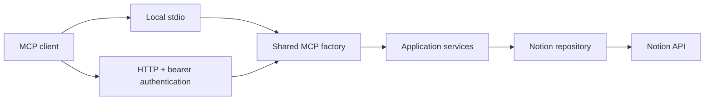

# DevMemory

**Notion-backed developer context for MCP clients.**

DevMemory connects clients such as Antigravity to developer project information
stored in Notion. A shared TypeScript application serves the same tools through
local stdio and authenticated, stateless Streamable HTTP.

> **Project status: active development.** Project listing and both transport
> implementations are available. The HTTP handler passes local contract tests;
> **hosted Vercel deployment is not yet verified**.

[Quickstart](#quickstart) · [Configuration](#configuration) ·
[MCP tools](#mcp-tools) · [Architecture](#architecture) ·
[Development](#development) · [Documentation](#documentation)

## Capabilities

- Read projects from Notion with status filtering, case-insensitive name matching,
  and bounded cursor pagination.
- Resolve the Projects, Subprojects, and Knowledge data sources and validate their
  required schemas before serving tools.
- Reuse one tool factory and business-service layer across stdio and HTTP.
- Protect remote MCP requests with SHA-256 bearer-token digests and token rotation.
- Provide structured stderr diagnostics, correlation IDs, and secret redaction.
- Expose separate health and authenticated readiness endpoints.

Notion is the only source of truth. The current integration is read-only; it does
not create records or change database schemas. Phase 1 does not introduce another
database, queue, vector store, or embeddings.

## Quickstart

### Prerequisites

| Requirement | Version / setup |
|---|---|
| Node.js | **24.22.1**; the project engine range is `>=24.22.1 <25` |
| npm | **11.19.1** |
| Notion API | **2025-09-03** |
| Notion access | An integration with read access to all three existing databases |
| MCP client | Required to use the local stdio server interactively |

### 1. Install and verify

```sh
git clone https://github.com/Sahil-Sojitra/Dev-Memory.git devmemory
cd devmemory
npm ci
npm run check
```

The checks use synthetic fixtures and do not require live credentials. The build
produces both the local entry and the function contract used in local tests.

### 2. Configure the process environment

Use [.env.example](.env.example) as the variable reference. Supply credentials
through the process environment or your hosting platform's protected settings.

**The application and verification scripts do not load `.env` automatically.**
Copying the template to `.env` alone does not configure a running process.

Required for local use:

```text
NOTION_API
NOTION_PROJECTS_DATABASE_ID
NOTION_SUBPROJECTS_DATABASE_ID
NOTION_KNOWLEDGE_DATABASE_ID
```

Set the database IDs, rather than substituting data-source IDs. Startup resolves
the actual data sources and validates their schemas. See [Configuration](#configuration)
for transport-specific settings.

### 3. Verify live Notion access

With the required variables available in the same shell:

```sh
npm run verify:notion
node scripts/verify-local.mjs
```

The first command checks metadata and schemas. The second starts the compiled
stdio application and tests initialization, discovery, project retrieval, filters,
and pagination where the available records permit it.

Both commands are read-only and report safe diagnostics without printing
credentials or record contents. Missing configuration or insufficient records is
reported as blocked, not passed.

### 4. Connect a local MCP client

Configure the client to launch Node directly with the compiled entry:

```json
{
  "mcpServers": {
    "devmemory": {
      "command": "<absolute-path-to-node-24.22.1-executable>",
      "args": ["<absolute-path-to-devmemory>/dist/index.js"],
      "cwd": "<absolute-path-to-devmemory>"
    }
  }
}
```

Replace the placeholders with absolute paths. The child process must inherit the
required environment variables. Do not put credentials into tracked client
configuration.

Launch `node dist/index.js` directly from the client; npm banners and watch-mode
output should not share the stdio protocol channel. This entry starts no HTTP
listener. Client configuration locations and loading behavior vary; use the
[tested Antigravity guidance](docs/local-mcp.md) to verify the effective setup.

## Configuration

All settings are validated with Zod. Invalid configuration fails closed.

| Variable | Required | Purpose / default |
|---|---|---|
| `NOTION_API` | Both transports | Notion integration credential |
| `NOTION_PROJECTS_DATABASE_ID` | Both transports | Projects database UUID |
| `NOTION_SUBPROJECTS_DATABASE_ID` | Both transports | Subprojects database UUID |
| `NOTION_KNOWLEDGE_DATABASE_ID` | Both transports | Knowledge database UUID |
| `NOTION_API_VERSION` | No | Fixed to `2025-09-03` |
| `NOTION_*_DATA_SOURCE_ID` | No | Optional expected-ID assertions for each resolved data source |
| `MCP_TRANSPORT` | No | `stdio` by default; use `http` for the function |
| `NODE_ENV` | No | `development`; also accepts `test` or `production` |
| `LOG_LEVEL` | No | `info`; standard Pino levels and `silent` are supported |
| `MCP_BEARER_TOKEN_SHA256` | HTTP | Current bearer token's SHA-256 digest: exactly 64 hex characters |
| `MCP_BEARER_TOKEN_NEXT_SHA256` | No | Optional next digest for rotation |
| `MCP_PUBLIC_URL` | HTTP | Public HTTPS endpoint URL without credentials, query, or fragment |
| `MCP_ALLOWED_ORIGINS` | No | Explicit comma-separated HTTPS origins; default empty |

The three database IDs must be distinct. Omit unused optional data-source
assertions and the next digest instead of assigning empty strings.

The Notion credential authorizes **DevMemory to access Notion**. The remote bearer
token authorizes **a client to access DevMemory**. Use separate credentials.

HTTP server configuration stores digests only. The legacy plaintext
`MCP_BEARER_TOKEN` variable is rejected in HTTP mode. Never commit a token or its
digest. See [token generation and rotation](docs/http-mcp.md#local-token-generation-manual-not-executed-by-the-agent)
for PowerShell-compatible instructions.

## MCP tools

### Available: `list_projects`

Returns application-owned project records with an ID, name, Notion URL, primary
stack, and optional description, repository URL, and status.

| Input | Contract |
|---|---|
| `nameContains` | Optional trimmed string, 1–200 characters; case-insensitive substring matching |
| `status` | Optional exact `Active`, `Paused`, or `Archived` |
| `limit` | Integer 1–100; default 50 |
| `cursor` | Optional opaque continuation string, 1–2048 characters without control characters |

Example tool arguments:

```json
{
  "nameContains": "memory",
  "status": "Active",
  "limit": 10
}
```

Response contract:

```typescript
{
  projects: Project[];
  hasMore: boolean;
  nextCursor: string | null;
}
```

**Pagination:** each call scans one bounded Notion page. Status filtering happens
in Notion; case-insensitive name matching happens in the service. A page can return
fewer or zero matches while `hasMore` is true. Continue with `nextCursor` and the
same filters and limit until `hasMore` is false.

### Planned tools

The following approved tools are not implemented yet:

- `get_project_context`
- `capture_knowledge`
- `search_knowledge`
- `get_knowledge_entry`

Validated Subprojects and Knowledge schemas do not yet expose their records as
business tools.

## Architecture



The modular monolith keeps transport handling, business rules, and external API
details separate. Notion SDK imports and SDK-specific types stay inside the
integration layer; services and tools use application-owned contracts.

Startup validates all three database/data-source identities and 24 required
properties, including types, option sets, and relation targets. Schema drift blocks
serving; startup never repairs or modifies Notion.

### Repository layout

```text
api/index.ts                 Vercel Web fetch entry
src/
  app.ts                     Application bootstrap and dependency wiring
  index.ts                   Local stdio entry
  config/                    Validated environment configuration
  domain/                    Project contracts, schema map, and stable errors
  integrations/notion/       SDK client, metadata reads, and project adapter
  services/                  Schema validation and project-listing rules
  mcp/                       Shared server factory and tool registration
  transports/                Stdio, HTTP, and bearer verification
  observability/             Logging, correlation context, and redaction
tests/
  fixtures/                  Synthetic API data and subprocess helpers
  *.test.ts                  Unit, adapter, security, and protocol tests
scripts/                     Lint and live read-only verification commands
docs/                        Architecture, contracts, and verification evidence
vercel.json                  Function routing and duration configuration
tsconfig*.json               Typechecking and both build targets
dist/                        Generated output; ignored by Git
```

## HTTP endpoints and hosting

| Endpoint | Methods | Access | Behavior |
|---|---|---|---|
| `/api/mcp` | POST | Bearer required | Stateless Streamable HTTP |
| `/api/health` | GET, HEAD | Public | Liveness only; no configuration or Notion reads |
| `/api/ready` | GET, HEAD | Bearer required | Validates initialization prerequisites; reuses warm results |

The root `api/index.ts` function uses the Web Request/Response contract.
`vercel.json` routes all three paths to this function. It opens no socket server
and reuses the same application bootstrap and tool factory as stdio.

Each MCP exchange gets a fresh SDK context without a session ID. Validated
application services and metadata can be cached per warm function. Readiness
failures have a 30-second retry cooldown.

Security boundaries include authentication before body processing, exact host
checks, an explicit Origin allowlist when Origin is present, a 64 KiB request
limit, a 4 MiB response limit, and a 45-second request deadline. Missing Origin
is supported for non-browser clients. No permissive CORS or distributed rate
limiter is introduced.

Modern responses use JSON; legacy responses retain finite SSE framing.
Subscriptions are disabled, and bounded responses are drained before contexts
are closed. This implementation does not provide indefinite notification streams.

**Deployment gate:** source conventions and the compiled fetch contract have been
verified locally. Actual Vercel builds, runtime selection, rewrites, HTTPS,
cold starts, live remote calls, and platform timeout behavior remain KAN-11 work.
Vercel manages Node patches; the exact local runtime patch is not a hosted guarantee.

## Development

| Command | Purpose |
|---|---|
| `npm ci` | Install the locked dependency graph |
| `npm run dev` | Run the TypeScript stdio entry in watch mode |
| `npm run typecheck` | Strictly check application, API, and test types |
| `npm run lint` | Check formatting and architecture boundaries |
| `npm test` | Run the deterministic test suite |
| `npm run test:watch` | Run tests in watch mode |
| `npm run build` | Compile both entry layouts |
| `npm run check` | Run typecheck, lint, tests, and build |
| `npm run verify:notion` | Verify live Notion metadata and schemas |
| `node scripts/verify-local.mjs` | Verify live compiled stdio behavior |

The local entry is built to `dist/index.js`. The function contract is built to
`dist/vercel/api/index.js` for local verification; Vercel discovers the source
entry in `api/`.

### Dependency policy

Use the approved Node/npm versions, exact package pins, lockfile, and nine npm
overrides. The repository `.npmrc` enforces strict engine/peer checks, exact saves,
and disabled dependency lifecycle scripts. Do not regenerate the dependency
baseline or upgrade packages as part of an unrelated change.

The full version inventory, maturity policy, and compatibility evidence are in
[the dependency baseline](docs/dependency-baseline.md). Vite belongs to the Vitest
toolchain; this repository has no frontend.

### Verification

The last recorded full run on **9 November 2026** passed **325 tests in 12 files**,
along with typecheck, lint, and both build targets. This is a recorded result,
not a claim of configured CI or a coverage percentage.

Tests cover schema drift, mapping, filtering, pagination, safe errors, redaction,
bearer rotation, authentication ordering, HTTP limits, concurrent stateless calls,
cleanup, and stdio protocol hygiene. Deterministic tests use synthetic credentials
and API responses; they do not load the repository `.env`.

Live Notion and Antigravity acceptance for local MCP was reported by the user at
the KAN-10 handoff. Agent-run synthetic checks and their provenance are preserved
in the linked reports. Hosted deployment is a separate, still-open verification gate.

## Contributing

Before submitting a change:

1. Keep business rules in services and reuse the shared tool factory.
2. Keep Notion SDK details inside `src/integrations/notion/`.
3. Add meaningful tests for changed behavior and run `npm run check`.
4. Update the relevant contract/configuration documentation.
5. Review the diff for credentials, generated output, and dependency changes.

Keep `.env`, client credentials, token digests, and private keys out of Git.
Application diagnostics belong on stderr; stdout is reserved for local MCP
protocol messages. Do not include real credentials or sensitive record contents in
issues or test fixtures.

## Documentation

| Document | Contents |
|---|---|
| [Architecture decisions](docs/architecture-decisions.md) | Approved scope and module/transport boundaries |
| [Dependency baseline](docs/dependency-baseline.md) | Exact versions, overrides, and dependency verification |
| [Compatibility spike](docs/mcp-compatibility-spike.md) | Historical MCP and Antigravity compatibility evidence |
| [Notion schema validation](docs/notion-schema-validation.md) | Schema map, configuration, and startup checks |
| [Local MCP](docs/local-mcp.md) | Tool contract, Antigravity setup, and local verification |
| [HTTP MCP](docs/http-mcp.md) | Authentication, rotation, security limits, and hosting gate |

## License

No `LICENSE` file is currently included in this repository.
